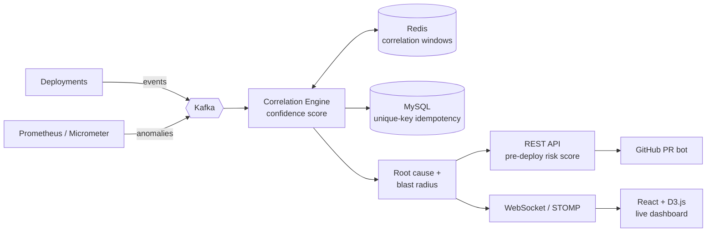
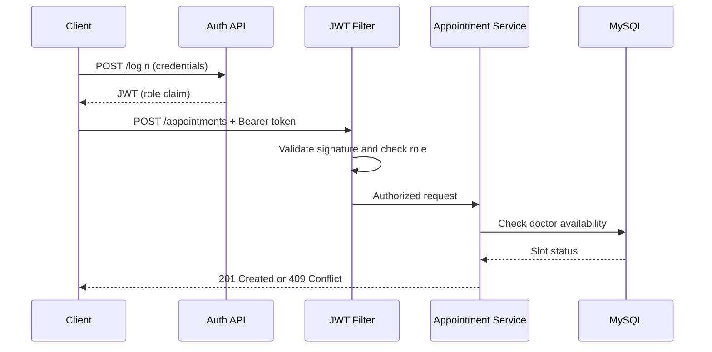
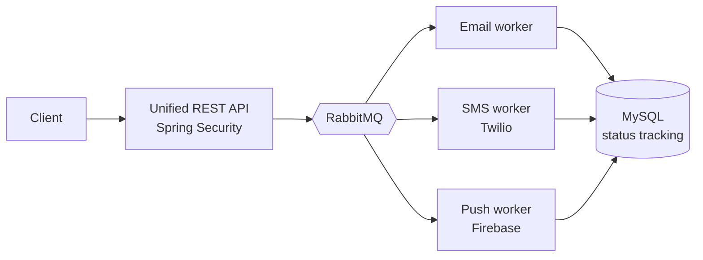
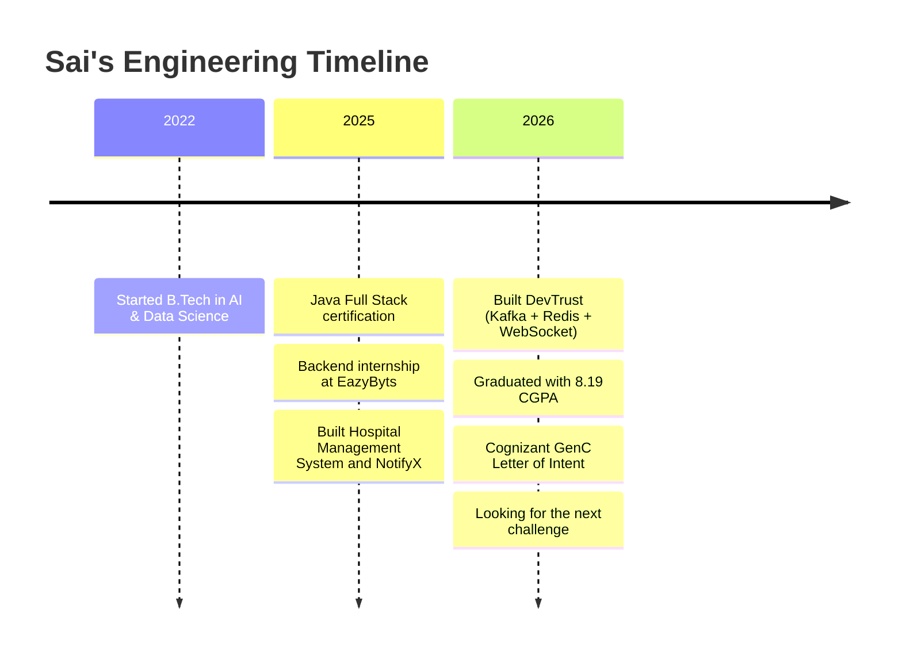

<!-- ═════════════════════════ HERO ═════════════════════════ -->
<div align="center">


<a href="https://github.com/Sai-kishore-veeranki">
  
</a>

<br/><br/>


<br/>

<a href="https://linkedin.com/in/sai-kishore-veeranki"></a>
<a href="mailto:saikishoreveeranki@gmail.com"></a>


</div>


<!-- ═════════════════════════ TERMINAL ABOUT ═════════════════════════ -->
## 🧑‍💻 `./about_me`

<table>
<tr>
<td width="50%" valign="top">

```bash
sai@kishore-dev ~ $ neofetch

  OS ........ Hyderabad, India
  Role ...... Backend Developer
  Degree .... B.Tech AI & Data Science
  CGPA ...... 8.19 / 10  (2026)
  Shell ..... Java 🍵 + Python 🐍
  Core ...... Spring Boot, Kafka, Redis
  Security .. JWT, OAuth2, RBAC
  Ships ..... 3 end-to-end projects
  Status .... ● Open to work
```

</td>
<td width="50%" valign="top">

```java
public class SaiKishore {

  String motto = "Clean code. Edge cases handled.";

  String[] superpowers = {
    "Event-driven design",
    "Secure REST APIs",
    "Debugging under pressure"
  };

  String funFact =
    "I built a bot that tells you "
  + "which deploy broke production.";

  boolean readyToContribute() {
    return true; // day one
  }
}
```

</td>
</tr>
</table>

---

## ⚡ Tech Arsenal

<div align="center">


</div>

<br/>

| Tier | Technologies |
|:--|:--|
| 🔥 **Core** | `Java` `Spring Boot` `REST API Design` `Spring Security (JWT/OAuth2)` `Hibernate/JPA` `MySQL` |
| ⚙️ **Working** | `Apache Kafka` `RabbitMQ` `Redis` `WebSocket/STOMP` `Docker` `Swagger/OpenAPI` `Prometheus` `Python` |
| 🌱 **Exploring** | `Microservices` `System Design` `Cloud & CI/CD` |

---

## 📊 GitHub Analytics

<div align="center">


<br/>


<br/>


<br/>


<br/>


<br/><br/>

<!-- 🐍 Contribution snake: needs the snake.yml workflow (see setup notes) -->
<picture>
  <source media="(prefers-color-scheme: dark)" srcset="https://raw.githubusercontent.com/Sai-kishore-veeranki/Sai-kishore-veeranki/output/github-snake-dark.svg" />
  <source media="(prefers-color-scheme: light)" srcset="https://raw.githubusercontent.com/Sai-kishore-veeranki/Sai-kishore-veeranki/output/github-snake.svg" />
  
</picture>

</div>

---

## 🚀 Featured Projects

> Click a project to see its architecture. These diagrams render natively on GitHub.

### 🛰️ DevTrust — Real-Time Engineering Intelligence Platform


Correlates production anomalies with deployments in real time. Confidence-scored correlation (time proximity + severity), idempotent processing via a DB unique constraint, auto-generated root cause summaries and blast-radius estimates, a pre-deploy risk scorer that comments on GitHub PRs, and a live React + D3.js dashboard.

<details>
<summary><b>🧠 View architecture</b></summary>



</details>

---

### 🏥 Hospital Management System


Secure backend for patients, doctors, and appointments. JWT-based RBAC for `ADMIN`, `DOCTOR`, `PATIENT`, with availability checks and conflict prevention in scheduling. All endpoints documented with Swagger/OpenAPI.

<details>
<summary><b>🔐 View auth flow</b></summary>



</details>

---

### 📣 NotifyX — Centralized Notification Platform


One REST API for email, SMS, and push. Asynchronous multi-channel delivery over RabbitMQ with status tracking, persistence, and reliable message processing. Integrates Twilio and Firebase, secured with Spring Security.

<details>
<summary><b>📬 View delivery pipeline</b></summary>



</details>


---

## 💼 Experience

<details open>
<summary><b>Full Stack Java Developer Intern</b> · EazyByts Web Solutions · <i>Sep 2025</i></summary>
<br/>

- 🔹 Built and tested backend features and REST endpoints with **Spring Boot** + **MySQL**
- 🔹 CRUD operations, request validation, and API integration on real project tasks
- 🔹 Code reviews and cross-stack debugging
- 🔹 Clean, modular code following team conventions

</details>

---

## 🏆 Milestones

<div align="center">

| | Milestone |
|:--:|:--|
| 🎓 | **8.19 CGPA**, B.Tech in AI & Data Science, S.R.K.R. Engineering College |
| 📜 | **Java Full Stack Development** certified, BlackBuck |
| 🤝 | **Cognizant GenC** Programmer Analyst Trainee, Letter of Intent |
| 💼 | **Backend internship** at EazyByts Web Solutions |
| ⚙️ | **3 production-style systems** shipped: Kafka, RabbitMQ, JWT, real-time dashboards |

</div>

---

## 🗺️ Journey




---

## 🌱 Currently Leveling Up

- ☁️ Cloud deployment and CI/CD pipelines
- 🧩 Microservices and system design
- 📈 Observability with Prometheus and Micrometer

## 📫 Let's Build Something

Hiring for an **entry-level Software / Backend Developer** role? I'd love to chat.

<div align="center">

<a href="mailto:saikishoreveeranki@gmail.com"></a>
<a href="https://linkedin.com/in/sai-kishore-veeranki"></a>

<br/><br/>


</div>
